# LedgerFlow · 中小企业财务管理系统

<div align="center">

**LedgerFlow** — A lightweight, integrated finance platform built for SMEs, following the *Chinese SME Accounting Standards*.
建账 → 凭证 → 账簿 → 报表 → 期末结账 · 一体化闭环 · 多账套 · RBAC · 全程留痕


</div>

---

## 预览

| 登录 | 经营看板 |
|:---:|:---:|
|  | 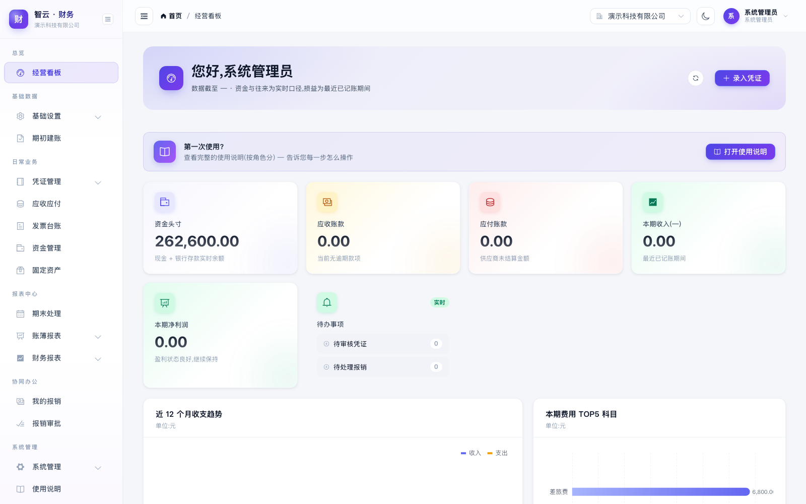 |

| 凭证录入(含附件影像) | 资产负债表 |
|:---:|:---:|
| 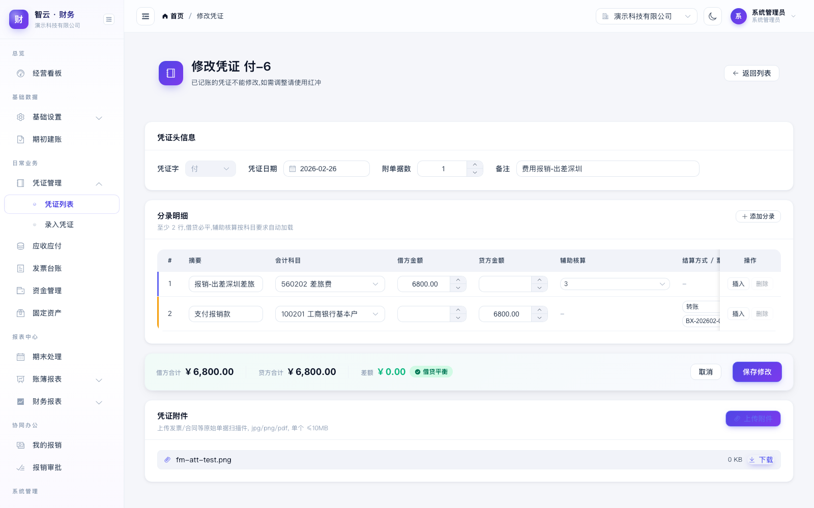 | 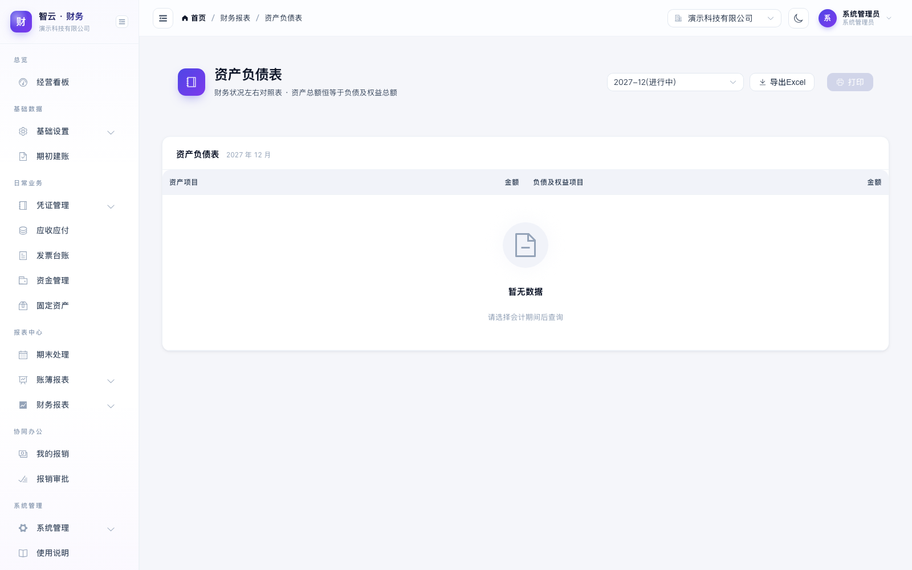 |

<details>
<summary><b>更多界面截图</b>(凭证列表 / 科目余额表 / 期末处理 / 我的报销 / 应收应付 / 资金管理 / 固定资产 / 用户管理 / 使用说明)</summary>

| 凭证列表 | 科目余额表 | 期末处理 |
|:---:|:---:|:---:|
| 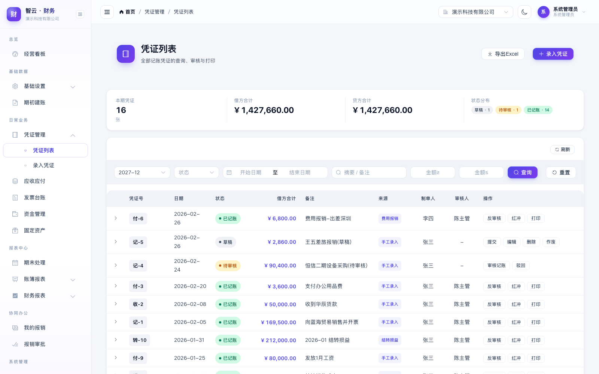 | 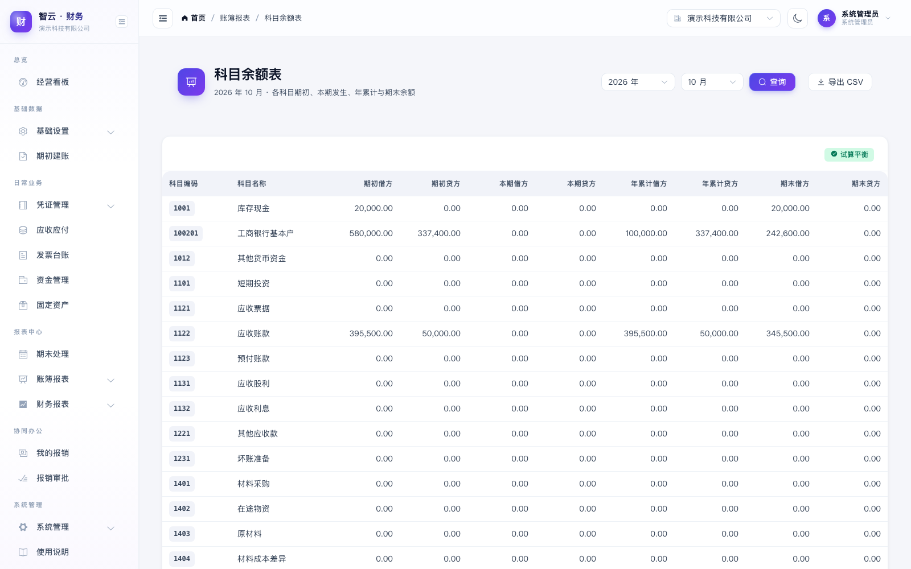 | 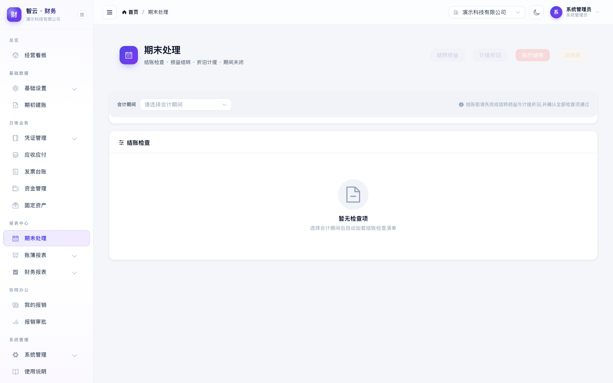 |

| 我的报销 | 应收应付 | 资金管理 |
|:---:|:---:|:---:|
| 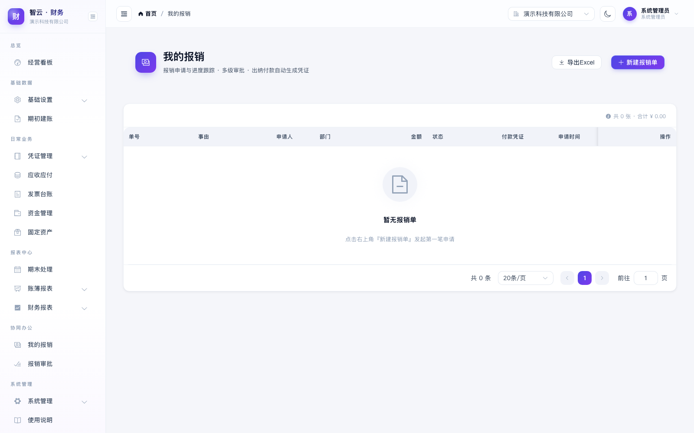 | 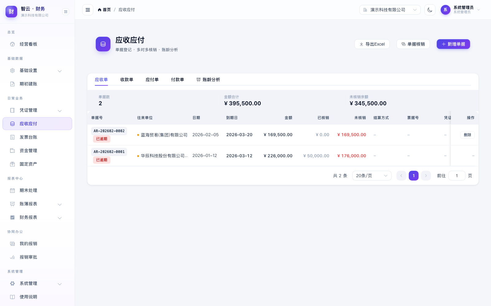 | 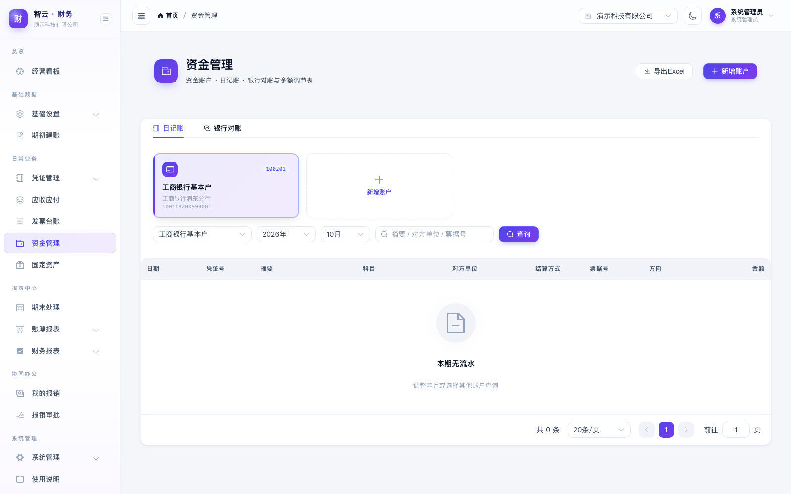 |

| 固定资产 | 用户管理 | 使用说明 |
|:---:|:---:|:---:|
| 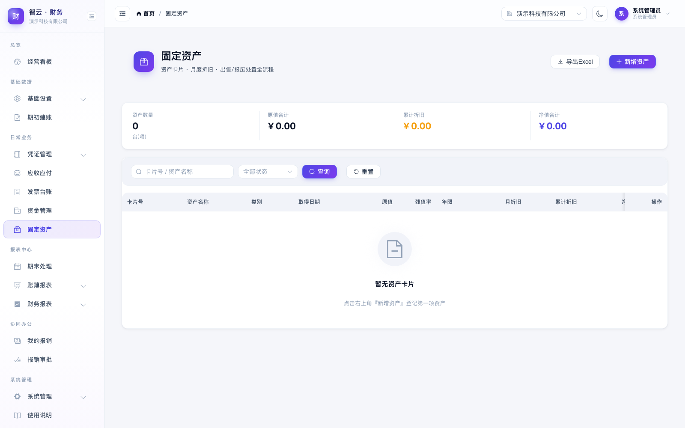 | 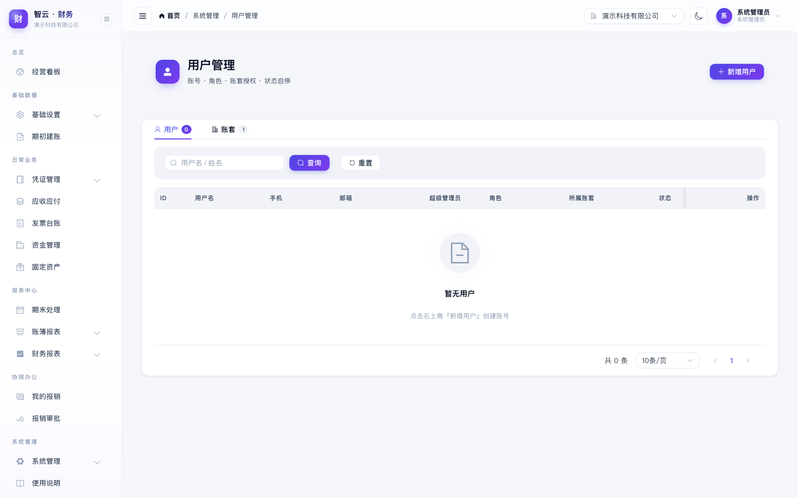 | 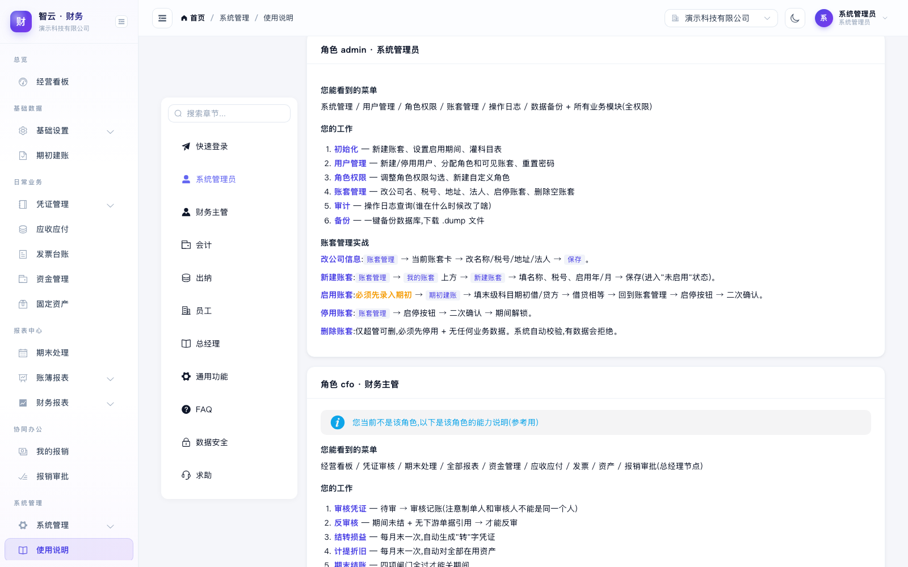 |

</details>

---

## 功能一览

| 模块 | 能力 |
| --- | --- |
| 基础设置 | 预置小企业会计准则科目表(4-2-2 分级)、往来单位/部门/项目/员工档案 |
| 期初建账 | 科目期初录入、试算平衡校验、一键启用账套 |
| 凭证管理 | 录入(借贷平衡/辅助核算强校验)→提交→审核→记账;驳回、反审核、作废、**红冲**;**附件影像上传/下载**;标准格式打印 |
| 账簿报表 | 总账口径科目余额表(含年累计)、明细分类账(逐笔+余额滚存);资产负债表(自动含未结转损益,实时平衡校验)、利润表(本期/年累计,剔除结转凭证口径) |
| 期末处理 | 结账检查清单(上期已结/无待审/损益已转/试算平衡)、结转损益向导(按科目+辅助维度分组,尾差自动调整)、计提折旧向导(平均年限法,当月增减规则)、结账/反结账 |
| 应收应付 | 应收/收款/应付/付款单据、多对多核销、账龄分析(0-30/31-60/61-90/90+)、收付款自动生成凭证 |
| 发票台账 | 进销项登记、CSV 批量导入、增值税统计(销项-进项)、销项发票一键生成应收单 |
| 资金管理 | 现金/银行日记账(联动凭证分录)、银行对账单导入、自动勾兑(金额±3日匹配)、手工勾兑、余额调节表 |
| 费用报销 | 填报→部门审批→(≥5000 元)总经理审批→财务复核→出纳付款,**付款自动生成记账凭证**;审批流金额阈值可配置;报销时效按账套业务期间校验 |
| 固定资产 | 卡片管理、购置凭证联动、月折旧计算、出售/报废清理凭证(固定资产清理过渡+净损益) |
| 经营看板 | 资金头寸、应收逾期、本月利润、12 月收支趋势(ECharts)、TOP5 费用、待办计数 |
| 系统管理 | RBAC 角色权限(权限目录化)、用户管理、多账套切换、操作日志(before/after 留痕)、pg_dump 一键备份下载 |

### 内置会计控制规则(节选)

- R1 每张凭证借贷必平且至少两行;R6 已记账凭证只能红冲不可改;R7 制单人与审核人强制分离;
- R8 反审核需期间未结且无下游单据引用;R9 结账四项检查全过才可关闭期间;R10 下期有凭证禁止反结账;
- R14 当月新增资产不提折旧、当月减少照提、提足自停;R15 全程 DECIMAL 运算,尾差 ≤0.01 自动消化;
- **业务时钟**:报销时效、红冲/付款默认日期均以账套当前业务期间为准,冻结/教学账套不因系统时间误判。

## 架构

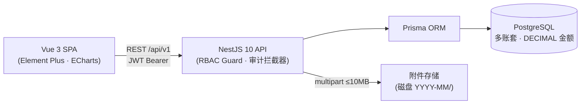

- 后端:NestJS + Prisma + PostgreSQL 15+(`server/`)
- 前端:Vue 3 + Vite + Element Plus + ECharts(`web/`)

## 快速开始

### 0. 前置条件

- Node.js ≥ 20(验证环境 v24)、pnpm ≥ 9
- 本机 PostgreSQL 15+(验证环境 16.15),TCP 5432;先创建超级用户可用的角色(下称 `$PGUSER`,按本机实际修改)

### 1. 初始化数据库

```bash
# 创建数据库(把 $PGUSER 换成本机 PostgreSQL 超级用户,如 postgres 或你自己的账号)
psql -h 127.0.0.1 -U $PGUSER -d postgres -c "CREATE DATABASE financial_mgmt ENCODING 'UTF8';"

cd server
pnpm install                 # 安装依赖(含 prisma generate)
pnpm exec prisma db push     # 建表
pnpm run db:seed             # 灌注角色/用户/演示账套/科目表/演示业务数据
```

连接串在 `server/.env` 的 `DATABASE_URL`,按本机实际账号密码修改。

### 2. 启动

```bash
# 开发模式(后端 :3100 + 前端 Vite :5173)
bash scripts/dev.sh

# 或生产/演示模式(构建前后端,vite preview 提供静态服务)
bash scripts/start-prod.sh
```

浏览器打开 [http://localhost:5173](http://localhost:5173) 即可使用。

### 演示账号

| 账号 | 密码 | 角色 | 典型操作 |
| --- | --- | --- | --- |
| admin | Admin@123 | 系统管理员 | 用户/角色/备份/日志 |
| cfo | Cfo@123 | 财务主管 | 审核凭证、结转损益、结账、报表复核 |
| zhangsan | Acc@123 | 会计 | 录入凭证、往来核销、折旧计提 |
| lisi | Cash@123 | 出纳 | 银行对账、报销付款 |
| wangwu | Emp@123 | 员工 | 填报报销 |
| boss | Boss@123 | 总经理 | 经营看板、大额审批 |

演示账套「演示科技有限公司」:2026-01 已完整结账,2026-02 进行中(含草稿/待审核凭证、未达账项等教学场景)。

## 目录结构

```
server/
  prisma/schema.prisma        # 数据模型(20+ 表)
  prisma/seed.ts              # 种子数据(幂等)
  src/
    common/                   # 统一响应/异常/JWT+RBAC 守卫/操作日志拦截器/业务时钟
    constants/                # 预置科目表/角色权限/报表公式(BS/IS 表驱动)
    modules/
      auth/                   # 登录/刷新令牌/切换账套
      system/                 # 用户/角色/日志/账套/备份
      masterdata/             # 科目/档案
      ledger/                 # 期初/凭证引擎/期末结账/余额计算核心
      report/                 # 报表引擎(公式配置驱动)/账簿查询
      business/               # 应收应付/发票/资金/报销/固定资产/看板
  scripts/e2e.mjs             # 端到端回归(44 项断言)
web/                          # Vue3 SPA(Element Plus)
  attachment-e2e.mjs          # 附件上传/下载端到端(需前后端运行中)
scripts/dev.sh|start-prod.sh  # 启动脚本
docs/                         # 开发文档/验收报告/截图
```

## 测试与验收

```bash
cd server
pnpm run test            # 单元测试(余额归一化/折旧边界/序列号)
CI=true pnpm run e2e     # E2E 44 项:认证/RBAC/凭证全流程/红冲/报表平衡/结账控制/核销/对账/报销流/折旧
cd ../web
pnpm build               # 生产构建
node smoke-e2e.mjs       # UI 冒烟 10 项(组件渲染/路由/图表/样式注入)
node attachment-e2e.mjs  # 附件上传→计数→下载 端到端
```

最近一次全量验证:**后端 E2E 44/44、单元测试 5/5、前端冒烟 10/10、附件端到端全通过**,详见 `docs/验收报告.md`。

## 备份与恢复

```bash
# 页面:系统管理 → 数据备份(一键备份/下载)
# 手工(将 $PGUSER 替换为本机数据库账号):
pg_dump -h 127.0.0.1 -U $PGUSER -d financial_mgmt -Fc -f backup.dump
pg_restore -h 127.0.0.1 -U $PGUSER -d financial_mgmt --clean backup.dump
```

## 文档

- **开发交接**:`docs/HANDOVER.md` ← 接手的工程师先读这个
- **架构文档**:`docs/ARCHITECTURE.md` ← 模块/数据流/安全
- **部署手册**:`docs/DEPLOY.md` ← 生产环境部署
- **开发指南**:`docs/DEV-GUIDE.md` ← 日常开发/调试/加功能
- **API 接口**:`docs/API-REFERENCE.md` ← REST API 完整清单
- **使用手册**:`docs/系统使用说明.md` ← 也集成在系统 `/help` 页面
- 历史:总体设计 `docs/财务管理系统开发文档.md` | 详细设计 `docs/开发详细设计文档.md` | 验收 `docs/验收报告.md` | 改进计划 `docs/不足与优化计划.md`

## 安全说明(交付默认值,生产请调整)

- JWT 密钥、数据库口令在 `.env`,上线前必须修改;建议启用 HTTPS 反向代理;
- 附件限 jpg/png/pdf ≤10MB;密码 bcrypt 存储;连续错登锁定、敏感操作留痕;
- 出纳无审核权、制单人不能 self-approve(系统硬约束,符合不相容岗位分离)。

## 已知边界(P2 待办)

- 工资核算、税务测算提示、金税对接、现金流量表完整版、移动端 App 未包含在一期(见开发文档 §14 决策点);
- 发票为登记台账模式,不做开票/查验集成。

---

<div align="center">

**LedgerFlow** · 让每一笔账都清晰可信

</div>
